# Tsuzuki — Aplikasi Pelacak Anime & Komik

**Tsuzuki** adalah aplikasi mobile Flutter yang dirancang untuk membantu pengguna melacak progres tontonan Anime dan bacaan Komik (Manga, Manhwa, Manhua). Aplikasi ini mengintegrasikan **AniList GraphQL API** untuk katalog data dan **Supabase (PostgreSQL)** untuk menyimpan koleksi pribadi pengguna.

---

## 👤 Identitas Mahasiswa
| | |
|---|---|
| **Nama** | I Kadek Dwi Bajaskara |
| **NIM** | 2415051068 |
| **Kelas** | PTI 5A |
| **Mata Kuliah** | Pemrograman Mobile |
| **Tema Project** | Media Tracker (Pelacak Anime & Komik) |
| **Versi** | 1.0.1 |
| **Branch Utama** | `main` |
| **Dosen** | Dr. Ir. I Ketut Resika Arthana, S.T., M.Kom |
| **Teaching Assistant** | Made Yuda Sadewa, S.Pd. |

---

## ✨ Fitur Utama

### 📚 Katalog & Pencarian

- Jelajahi **Anime, Manga, Manhwa, dan Manhua** dari AniList API.
- Fitur **pencarian** judul secara **real-time** dengan debounce.
- **Filter lanjutan**: Genre, Tag, Tahun Rilis, Status Tayang, dan Skor Minimum.
- **Pengurutan**: Populer, Skor Tertinggi, Terbaru, A-Z, dan Relevan.
- **Random Pick** (Acak) untuk merekomendasikan judul dari katalog.
- Carousel **Anime Populer** dan **Komik Populer** di halaman Home.

### 📖 Detail & Karakter

- Sinopsis lengkap dengan **terjemahan otomatis** (EN → ID via Google Translate dengan caching).
- Informasi studio, durasi, total episode/chapter, dan status tayang.
- **Daftar karakter** (Main, Supporting, Background) dengan detail voice actor.
- **Judul alternatif** (Romaji, English, Native, Sinonim).
- Preview cover fullscreen dengan **zoom & pan**.

### 🗂️ Koleksi Pribadi (CRUD)

- **Create**: Tambah judul dari katalog ke koleksi pribadi.
- **Read**: Lihat koleksi dengan tampilan **Grid/List** yang bisa dikustomisasi.
- **Update**: Edit status, progres, rating, catatan, dan label.
- **Delete**: Hapus dengan **dialog konfirmasi** dan opsi **Undo via SnackBar**.
- **Aksi Massal**: Pilih banyak item untuk hapus, ubah status, atau ubah label sekaligus.
- **Deteksi Duplikat**: Peringatan jika judul sudah ada di koleksi.

### 📊 Pelacakan Progres

- Tombol cepat **+1 / -1** untuk menambah/mengurangi episode/chapter.
- **Auto-update status**: Jika progres mencapai total, status otomatis menjadi "Selesai".
- **Validasi progres**: Tidak boleh negatif dan tidak boleh melebihi total.
- **Saran otomatis**: Jika progres penuh tetapi status belum "Selesai", aplikasi menawarkan untuk mengubahnya.

### ⭐ Favorit & Label Kustom

- Tandai judul sebagai **favorit** dengan ikon hati.
- Halaman **Favorit Saya** dengan filter (Semua / Anime / Komik).
- Buat **label berwarna** untuk mengelompokkan koleksi.

### 💾 Backup & Restore

- **Ekspor** koleksi ke file **JSON** (bisa dibagikan ke Google Drive/Files).
- **Impor** koleksi dari file JSON dengan mode **Gabungkan** (Merge) atau **Ganti Semua** (Replace).
- **Backup otomatis** sebelum impor mode Replace untuk keamanan.

### 🌐 Multi-Bahasa & Tema

- Mendukung **Bahasa Indonesia** dan **English** (real-time tanpa restart).
- **Tema Dinamis**: Mode Gelap, Terang, dan Ikuti Sistem.
- **Kustomisasi Tampilan**: Ukuran card (Kecil/Sedang/Besar), jumlah item per baris (2–6), dan mode Grid/List.

### 🔞 Sensor Konten NSFW

- **Filter** konten 18+ di katalog (default: nonaktif).
- **Sensor cover & judul**: Blur otomatis dengan tap-to-reveal.
- **3 Tingkat Sensor**: Nonaktif, Ringan, Berat (dengan konfirmasi).
- **Sembunyikan badge 18+** untuk keperluan screenshot.

### 📱 Responsif

Layout menyesuaikan lebar layar (`lib/core/screen_breakpoints.dart`, `lib/screens/responsive_shell.dart`):

- **Compact** (< 600dp): Bottom Navigation Bar.
- **Medium** (600–840dp): Navigation Rail dengan ikon saja.
- **Expanded** (≥ 840dp): Navigation Rail dengan ikon dan label.
- **Large** (≥ 1200dp): Navigation Rail dengan label untuk layar sangat lebar.
- Jumlah kolom grid katalog dan koleksi dapat diatur pengguna (2–6 item per baris).

### 🔄 Mode Offline & Sinkronisasi

- **Cache lokal** koleksi menggunakan SharedPreferences.
- **Deteksi koneksi** otomatis dengan banner offline.
- **Auto-retry** koneksi setiap 30 detik saat offline.
- **Klaim koleksi tamu**: Pindahkan data koleksi guest ke akun saat login.

### ⚙️ Fitur Tambahan

- **Update Aplikasi**: Cek update otomatis via GitHub Releases, download, dan install APK langsung dari dalam aplikasi.
- **Mode Tamu**: Jelajahi katalog tanpa login (dengan batasan fitur).
- **Debug Info**: Halaman diagnosa untuk melihat status koneksi, versi aplikasi, dan error terakhir.
- **Statistik Profil**: Total judul, episode, chapter, volume, dan estimasi waktu menonton.
- **Manajemen Storage**: Lihat dan hapus cache gambar, koleksi, dan terjemahan.
- **Onboarding**: 3 slide pengenalan aplikasi untuk pengguna baru.
- **Halaman Bantuan**: FAQ lengkap dengan pencarian.

---

## 📸 Screenshot Aplikasi

Semua screenshot disimpan di folder `docs/screenshots/`.

### Onboarding & Autentikasi

| Onboarding 1 | Onboarding 2 | Login / Register |
|:---:|:---:|:---:|
| 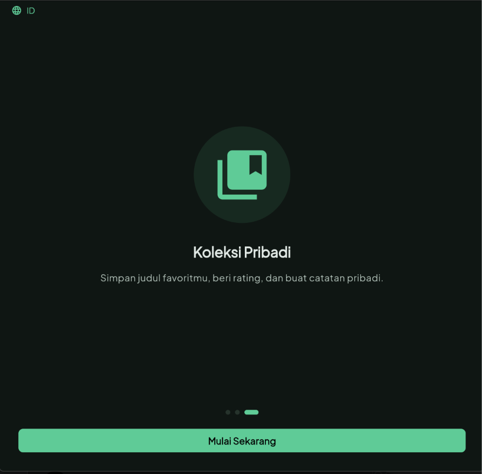 | 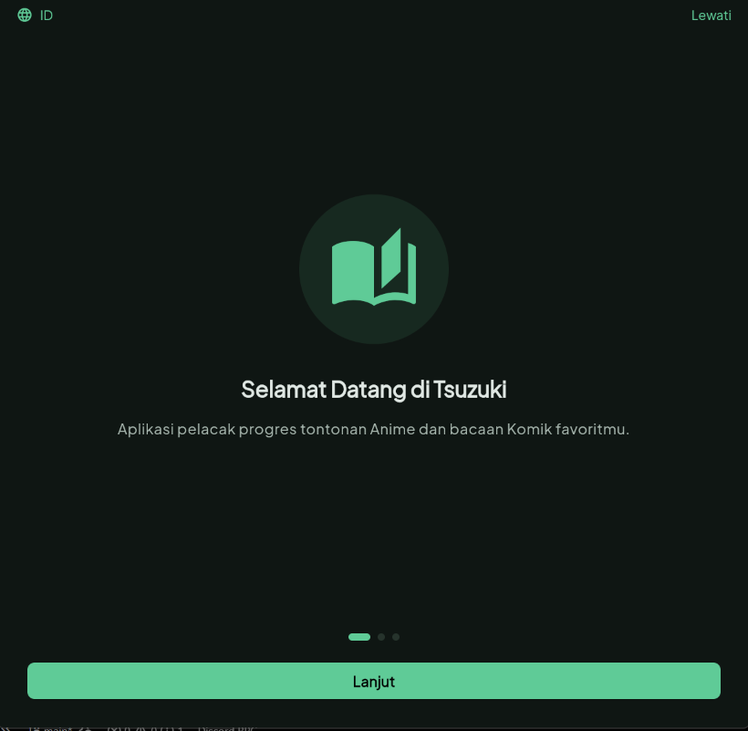 | 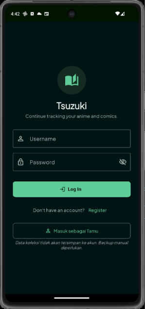 |

### Home

| Home | Home (lanjutan) |
|:---:|:---:|
| 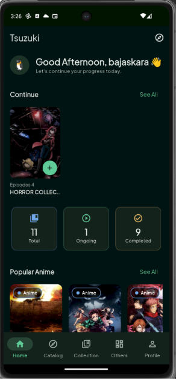 | 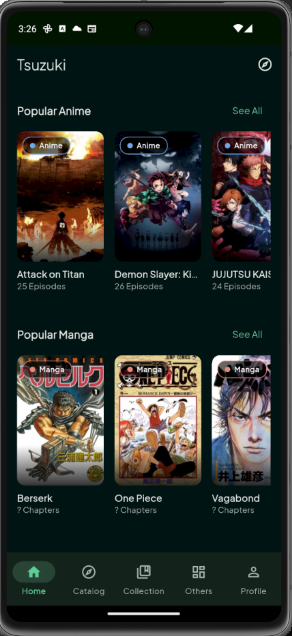 |

### Katalog (Data dari AniList API)

| Katalog | Katalog (2) | Katalog (3) |
|:---:|:---:|:---:|
| 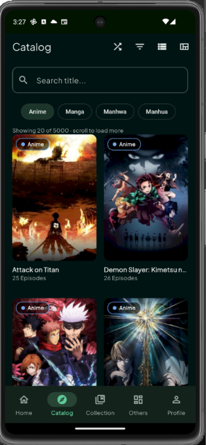 | 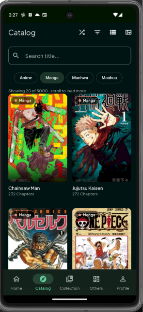 | 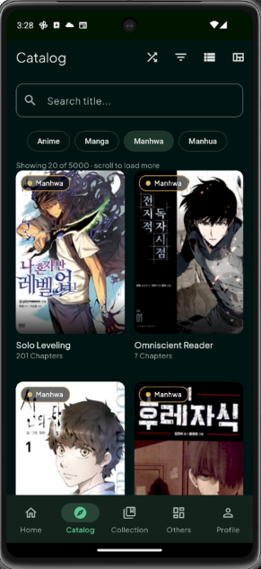 |

| Katalog (4) | Filter Katalog | Pengaturan Grid |
|:---:|:---:|:---:|
| 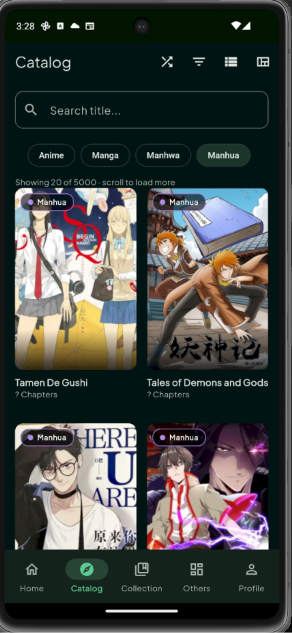 | 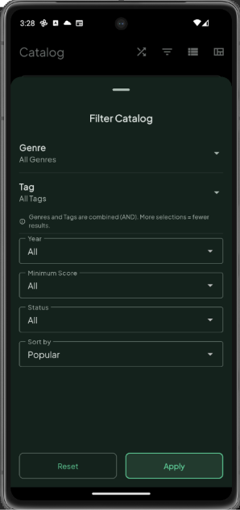 | 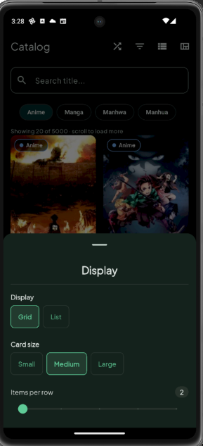 |

| Tampilan List | | |
|:---:|:---:|:---:|
| 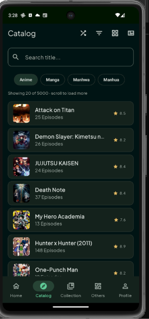 | | |

### Detail & Karakter

| Detail Katalog | Detail Katalog (2) | Daftar Karakter |
|:---:|:---:|:---:|
| 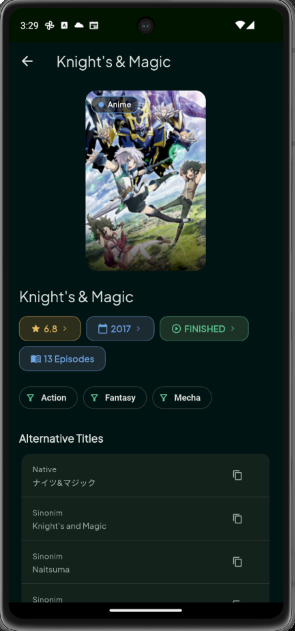 | 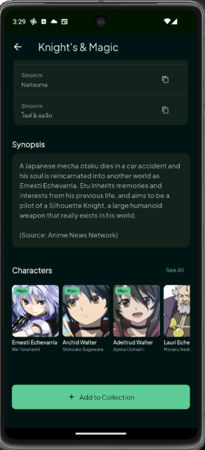 | 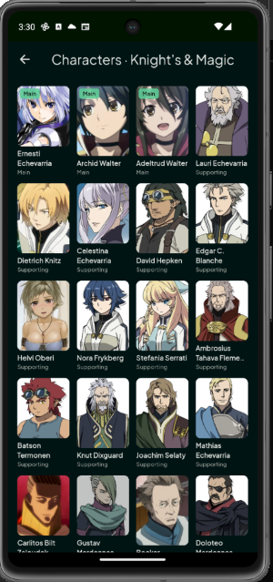 |

### Koleksi (CRUD)

**Create (Tambah Koleksi)**

| Form Tambah | Form Tambah (2) |
|:---:|:---:|
| 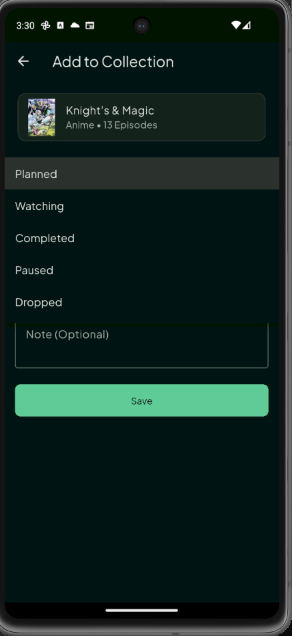 | 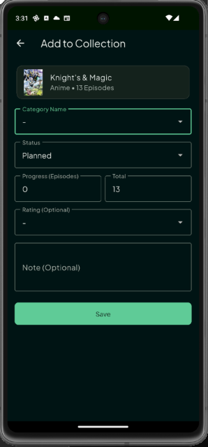 |

**Read (Daftar & Detail Koleksi)**

| Koleksi (Grid) | Koleksi (Grid 2) | Koleksi (List) |
|:---:|:---:|:---:|
| 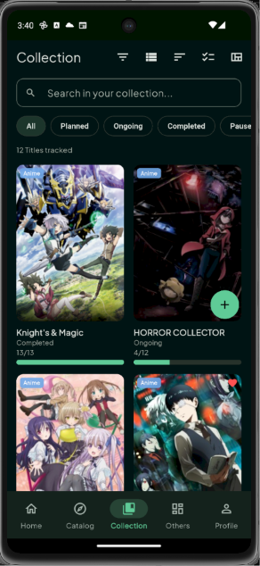 | 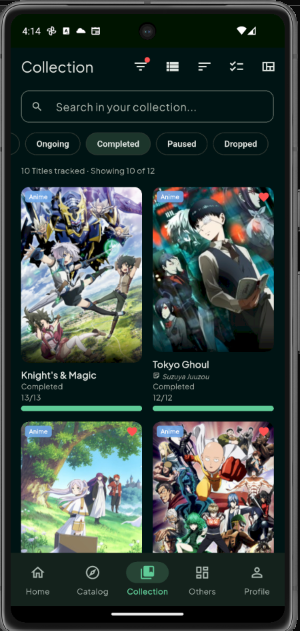 | 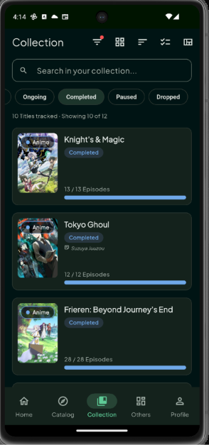 |

| Urutkan Koleksi | Detail Koleksi | |
|:---:|:---:|:---:|
| 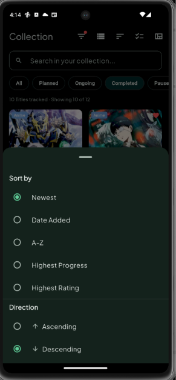 | 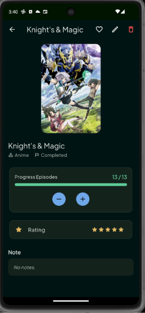 | |

**Update (Edit Koleksi)**

| Form Edit | Form Edit (2) |
|:---:|:---:|
| 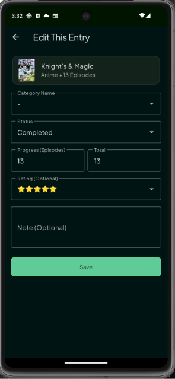 | 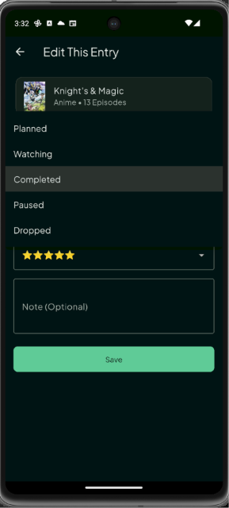 |

### Favorit, Profil & Statistik

| Favorit | Profil | Profil (2) |
|:---:|:---:|:---:|
| 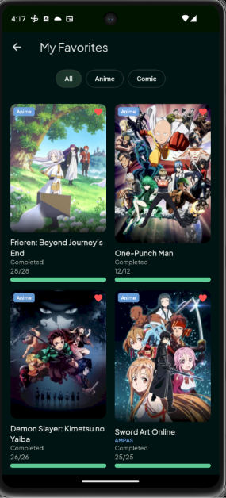 | 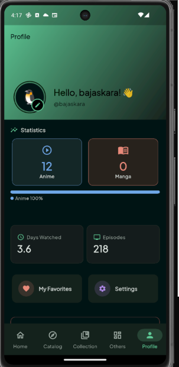 | 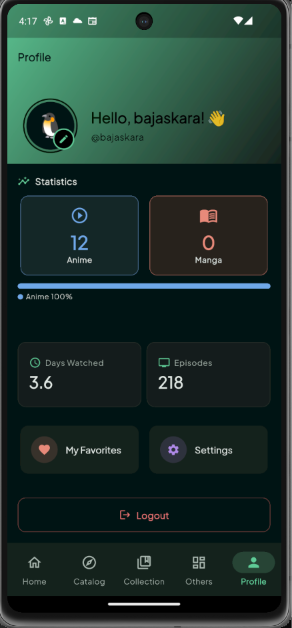 |

| Statistik | | |
|:---:|:---:|:---:|
| 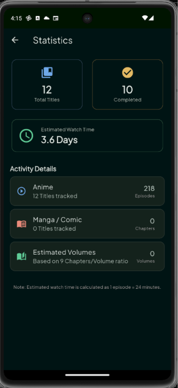 | | |

### Halaman Lainnya

| Lainnya | Pengaturan | Storage |
|:---:|:---:|:---:|
| 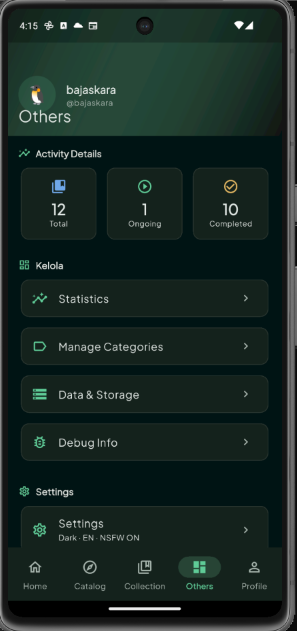 | 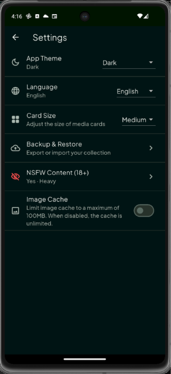 | 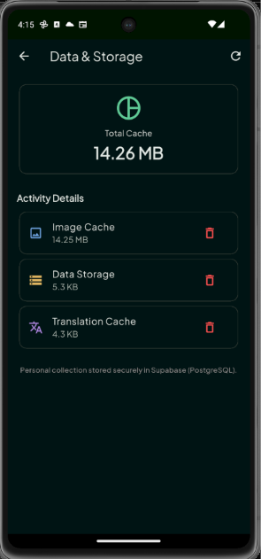 |

| Bantuan | Tentang | Debug Info |
|:---:|:---:|:---:|
| 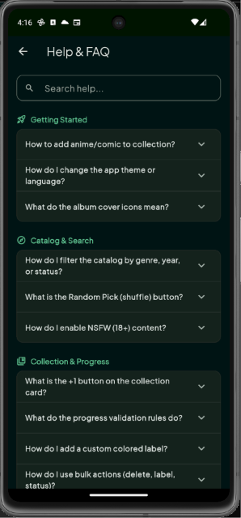 | 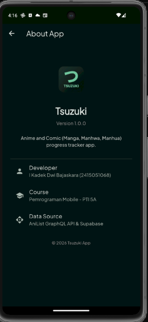 | 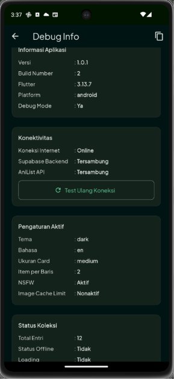 |

---

## 🛠️ Tech Stack
| Kategori | Teknologi |
|---|---|
| **Framework** | Flutter (Dart SDK ^3.5.0) |
| **State Management** | Provider + ChangeNotifier |
| **Backend/Database** | Supabase (PostgreSQL) |
| **Backend SDK** | `supabase_flutter` |
| **API Eksternal** | [AniList GraphQL API](https://anilist.gitbook.io/anilist-apiv2-docs/) |
| **Local Storage** | SharedPreferences & JSON Cache |
| **Networking** | `http` & `dio` |
| **Konfigurasi** | `flutter_dotenv` (file `.env`) |
| **Image Caching** | `cached_network_image` & `flutter_cache_manager` |
| **Localization** | `flutter_localizations` + `intl` |
| **Fonts** | Google Fonts (Plus Jakarta Sans) |
| **Icons & Splash** | `flutter_launcher_icons` & `flutter_native_splash` |
| **File Handling** | `file_selector`, `share_plus`, `path_provider` |
| **Update & Install** | `package_info_plus`, `open_filex` |
| **Utilitas** | `url_launcher`, `persistent_device_id` |

---

## 🏗️ Arsitektur Aplikasi

Aplikasi ini menggunakan **arsitektur berlapis (layered architecture)** untuk memisahkan tanggung jawab dan memudahkan **maintenance**.

### Struktur Folder

```text
lib/
├── core/                         # Konfigurasi inti (tema, warna, ukuran, cache, config)
│   ├── app_cache_manager.dart
│   ├── app_colors.dart
│   ├── app_config.dart
│   ├── app_extras.dart
│   ├── app_sizes.dart
│   ├── app_theme.dart
│   ├── profile_backgrounds.dart
│   ├── screen_breakpoints.dart
│   └── title_actions.dart
│
├── l10n/                         # File lokalisasi (terjemahan ID/EN)
│   ├── app_localizations.dart
│   ├── app_localizations_en.dart
│   ├── app_localizations_id.dart
│   ├── app_en.arb
│   └── app_id.arb
│
├── models/                       # Class Dart (Data Model)
│   ├── card_size_enum.dart
│   ├── catalog_item.dart
│   ├── character_item.dart
│   ├── collection_entry.dart
│   ├── custom_label.dart
│   ├── media_type_enum.dart
│   ├── nsfw_settings.dart
│   ├── profile_stats.dart
│   ├── status_collection_enum.dart
│   └── update_info.dart
│
├── providers/                    # State Management (ChangeNotifier)
│   ├── auth_provider.dart
│   ├── catalog_provider.dart
│   ├── collection_provider.dart
│   ├── label_provider.dart
│   └── settings_provider.dart
│
├── repositories/                 # Jembatan antara Provider dan Service (fitur koleksi)
│   └── collection_repository.dart
│
├── screens/                      # Halaman UI
│   ├── auth/                     # Login, Register, Guest, AuthGate
│   ├── catalog/                  # CatalogPage, CatalogDetailPage, CharacterListPage
│   ├── collection/               # CollectionPage, CollectionDetailPage, EntryForm, Edit, Favorites
│   ├── debug/                    # DebugInfoPage
│   ├── home/                     # HomePage
│   ├── info/                     # AboutPage, HelpPage, StatisticsPage
│   ├── onboarding/               # OnboardingPage
│   ├── other/                    # OtherPage
│   ├── profile/                  # ProfilePage, EditProfilePage
│   ├── settings/                 # SettingsPage, LabelPage, NsfwSettingsPage, BackupRestorePage, StoragePage
│   └── responsive_shell.dart
│
├── services/                     # Logika API & Database
│   ├── anilist_service.dart
│   ├── auth_service.dart
│   ├── backup_service.dart
│   ├── collection_data_source.dart
│   ├── label_service.dart
│   ├── supabase_collection_service.dart
│   ├── translation_service.dart
│   └── update_service.dart
│
├── widgets/                      # Komponen UI Reusable
│   ├── adult_badge.dart
│   ├── alternative_titles_section.dart
│   ├── character_section.dart
│   ├── collection_card.dart
│   ├── collection_list_card.dart
│   ├── cover_image.dart
│   ├── cover_preview_dialog.dart
│   ├── display_mode_sheet.dart
│   ├── empty_view.dart
│   ├── error_view.dart
│   ├── media_card.dart
│   ├── media_type_chip.dart
│   ├── nsfw_blur_wrapper.dart
│   ├── progress_bar.dart
│   ├── shimmer_loading.dart
│   ├── update_dialog.dart
│   ├── forms/
│   │   └── entry_form_fields.dart
│   └── skeleton/
│       ├── skeleton_base.dart
│       ├── skeleton_grid_card.dart
│       └── skeleton_list_card.dart
│
└── main.dart                     # Entry point aplikasi
```

### Alur Data (Data Flow)

```text
┌─────────────────┐
│ UI (Screen)     │ ← Mengonsumsi state, mengirim aksi (tap, input)
└────────┬────────┘
         │ watch/read
         ▼
┌─────────────────┐
│ Provider        │ ← Mengelola state (loading, data, error), notifyListeners()
└────────┬────────┘
         │ memanggil
         ▼
┌─────────────────┐
│ Repository      │ ← Abstraksi antara Provider dan Service (fitur koleksi)
└────────┬────────┘
         │ memanggil
         ▼
┌─────────────────┐
│ Service         │ ← Implementasi konkret (Supabase / AniList API)
└────────┬────────┘
         │ HTTP / SQL
         ▼
┌─────────────────┐
│ API / Database  │
└─────────────────┘
```

**Prinsip utama**: alur data mengikuti UI → Provider → Repository → Service → API/Database. Alur lengkap ini diterapkan pada fitur inti **koleksi** (`CollectionProvider` → `CollectionRepository` → `SupabaseCollectionService`). Provider katalog, autentikasi, dan label memanggil service secara langsung. Beberapa halaman pendukung (Detail Katalog, Daftar Karakter, Backup/Restore, dan pengecekan update di Home) juga memakai service langsung untuk data yang hanya dibutuhkan halaman tersebut.

---

## 🗄️ Skema Database (Supabase)

### Tabel `koleksi` (Tabel Utama, 16 kolom: 1 PK + 15 kolom data)
| Kolom | Tipe | Keterangan |
|---|---|---|
| `id` | `bigint` (PK) | Primary key, auto-increment |
| `user_id` | `uuid` (FK) | Referensi ke `auth.users` |
| `device_id` | `text` | ID perangkat (untuk klaim data guest) |
| `jenis` | `text` | `anime`, `manga`, `manhwa`, `manhua`, `lainnya` |
| `label_id` | `bigint` (FK) | Referensi ke `label_kustom` |
| `external_id` | `text` | ID dari AniList (contoh: `al:12345`) |
| `judul` | `text` | Judul anime/komik |
| `cover_url` | `text` | URL gambar cover |
| `status` | `text` | `direncanakan`, `sedang`, `selesai`, `ditunda`, `dihentikan` |
| `progres` | `int` | Episode/chapter yang sudah ditonton/dibaca |
| `total` | `int` | Total episode/chapter |
| `rating` | `int` | Rating 1–5 |
| `catatan` | `text` | Catatan pribadi |
| `is_favorite` | `boolean` | Status favorit |
| `created_at` | `timestamptz` | Waktu dibuat |
| `updated_at` | `timestamptz` | Waktu terakhir diubah |

### Tabel `label_kustom`
| Kolom | Tipe | Keterangan |
|---|---|---|
| `id` | `bigint` (PK) | Primary key, auto-increment |
| `user_id` | `uuid` (FK) | Referensi ke `auth.users` |
| `nama` | `text` | Nama label |
| `warna` | `text` | Kode hex warna (contoh: `#5FCB97`) |

### Tabel `profiles`
| Kolom | Tipe | Keterangan |
|---|---|---|
| `id` | `uuid` (PK) | Referensi ke `auth.users` |
| `username` | `text` | Username unik |
| `display_name` | `text` | Nama tampilan |
| `avatar_emoji` | `text` | Emoji avatar |
| `created_at` | `timestamptz` | Waktu registrasi |

### RPC Functions (Supabase)

- `check_username_available(p_username)` → Cek ketersediaan username.
- `delete_own_account()` → Hapus akun sendiri (rollback registrasi).
- `claim_device_collections(p_device_id)` → Klaim koleksi dari perangkat guest.

---

## 🌐 REST/GraphQL API yang Digunakan
| API | Metode | Endpoint | Fungsi |
|---|---|---|---|
| **AniList GraphQL** | POST | `https://graphql.anilist.co` | Katalog anime/manga, detail, karakter, genre, tag |
| **Google Translate** (endpoint tidak resmi) | GET | `https://translate.googleapis.com/translate_a/single` | Terjemahan sinopsis EN → ID |
| **GitHub Releases API** | GET | `https://api.github.com/repos/{owner}/{repo}/releases/latest` | Cek update APK terbaru |

Respons JSON dari ketiga API diubah menjadi model Dart (misalnya `ItemKatalog.fromAniList`, `KarakterAnime.fromEdge`, `UpdateInfo.fromGitHub`) dan ditampilkan di UI dengan state loading, error, dan empty.

**Contoh Query AniList:**

```graphql
query ($page: Int, $type: MediaType, $sort: [MediaSort]) {
  Page(page: $page, perPage: 20) {
    pageInfo {
      hasNextPage
      total
    }
    media(type: $type, sort: $sort, isAdult: false) {
      id
      title {
        romaji
        english
        native
      }
      coverImage {
        large
      }
      averageScore
      episodes
      chapters
      status
      genres
    }
  }
}
```

---

## 🚀 Cara Menjalankan Project

### Prasyarat

- Flutter SDK >= 3.27.0
- Dart SDK ^3.5.0
- Akun Supabase (gratis)
- Android Studio / VS Code dengan plugin Flutter

### Langkah-langkah

**1. Clone repository:**

```bash
git clone https://github.com/shiroKaraa/UTS_2415051068_I_Kadek_Dwi_Bajaskara.git
cd UTS_2415051068_I_Kadek_Dwi_Bajaskara
```

**2. Buat file `.env` di root project (sejajar dengan `pubspec.yaml`):**

```bash
cp .env.example .env
```

Lalu isi nilainya:

```env
SUPABASE_URL=https://xxxxxxxxxxxx.supabase.co
SUPABASE_ANON_KEY=isi_dengan_anon_public_key
```

> File `.env` terdaftar sebagai asset di `pubspec.yaml`, jadi harus ada sebelum aplikasi dijalankan atau di-build. Gunakan **anon public key**. Jangan pernah memakai `service_role` key. File `.env` sudah masuk `.gitignore` dan tidak boleh di-commit.

**3. Siapkan Supabase:**

- Buat project baru di Supabase Dashboard.
- Buat tabel `koleksi`, `label_kustom`, dan `profiles` sesuai bagian **Skema Database** di atas.
- Buat 3 fungsi RPC: `check_username_available`, `delete_own_account`, dan `claim_device_collections`.
- Aktifkan Row Level Security (RLS) pada setiap tabel dan batasi akses berdasarkan `user_id`.
- Matikan "Confirm email" di Authentication → Providers → Email.
- Salin Project URL dan anon public key ke file `.env`.

**4. Install dependencies:**

```bash
flutter pub get
```

**5. Generate localizations (jika belum):**

```bash
flutter gen-l10n
```

**6. Jalankan aplikasi:**

```bash
flutter run
```

**7. Jalankan test (opsional):**

```bash
flutter test
```

**8. Build APK Release (opsional):**

```bash
flutter build apk --release
```

---

## 📦 Link APK & Dokumentasi
| Deliverable | Link |
|---|---|
| APK Release (v1.0.1) | [Download APK](https://github.com/shiroKaraa/UTS_2415051068_I_Kadek_Dwi_Bajaskara/releases/tag/v1.0.1) |
| LAMPIRAN | [UTS_2415051068_I_Kadek_Dwi_Bajaskara.pdf](https://drive.google.com/drive/folders/1QtaqE8D0066MRBD4mLoqBwQQGTTSvgea?usp=sharing) |
| Git Log | [Lihat Commit History](https://github.com/shiroKaraa/UTS_2415051068_I_Kadek_Dwi_Bajaskara/commits/main) |

---

## 📝 Catatan Pengembangan

- **Git History**: 98 commit yang di-push bertahap sejak 25 Oktober 2026, mencakup inisialisasi, arsitektur, UI, responsive layout, navigasi, model, state management, integrasi REST API, database, CRUD, interaksi, error handling, hingga finalisasi.
- **Testing**: 3 file test di folder `test/` (unit test dan widget test). Jalankan dengan `flutter test`.
- **Code Quality**: Menggunakan `flutter_lints` untuk menjaga kualitas kode.
- **Kendala utama**: Rate limit AniList API (saat ini 30 request/menit, normalnya 90) diatasi dengan caching katalog 2 jam dan penanganan HTTP 429. Mode offline dengan cache lokal dan auto-retry 30 detik mengantisipasi koneksi terputus.

---

## 📄 Lisensi

Project ini dibuat untuk keperluan **Ujian Tengah Semester (UTS)** Mata Kuliah Pemrograman Mobile di Universitas Pendidikan Ganesha (Undiksha). Tidak untuk digunakan secara komersial.

---

## 🙏 Ucapan Terima Kasih

- **Dr. Ir. I Ketut Resika Arthana, S.T., M.Kom** — Dosen Pengampu.
- **Made Yuda Sadewa, S.Pd.** — Teaching Assistant.
- **AniList** — Penyedia API katalog anime/manga.
- **Supabase** — Penyedia backend database.

---

<p align="center">
  <b>© 2026 Tsuzuki App · I Kadek Dwi Bajaskara (2415051068)</b><br>
  <i>Dibuat dengan ❤️ menggunakan Flutter</i>
</p>